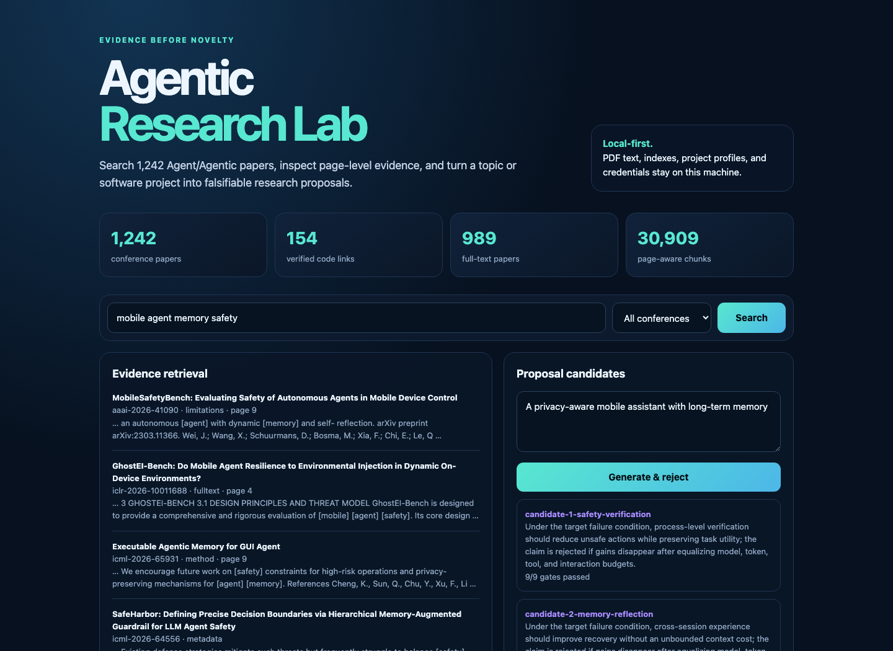
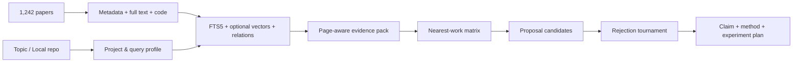
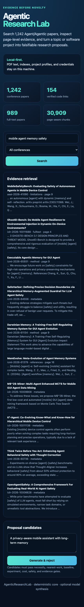

<div align="center">

# AgenticResearchLab

### Evidence-grounded research intelligence for Agentic AI

把论文、代码与本地工程转化为可引用、可证伪、可执行的 Agentic Paper 研究方案。

[](https://github.com/Harzva/AgenticResearchLab/actions/workflows/ci.yml)
[](pyproject.toml)
[](awesome/all-agentic-papers-2026/README.md)
[](src/agentic_research_lab/data/code_repositories_2026.json)
[](LICENSE)

[快速开始](#30-秒开始) · [完整论文库](awesome/all-agentic-papers-2026/README.md) · [Mobile Agentic AI](awesome/mobile-agentic-ai/README.md) · [升级计划](docs/next-upgrade-plan.md) · [视觉预览](docs/readme-assets/gallery.html)

</div>

<!-- showcase:start -->
<p align="center">
  
</p>
<!-- showcase:end -->

> **Evidence before novelty.** AgenticResearchLab 不把“增加多个 Agent”当作创新。它先检索最近工作与页码级证据，再要求候选方案通过 Agentic 必要性、Baseline、公平预算、实验、消融、成本、安全与复现门槛。

## 已经可以做什么

| 能力 | 当前状态 | 可验证结果 |
| --- | --- | --- |
| 会议论文目录 | ✅ 稳定 | 1,242 篇 AAAI / ICLR / ICML / IJCAI / ECCV 2026 论文 |
| 论文代码富化 | ✅ 稳定 | 158 个显式候选，154 个 GitHub 实时验证通过，4 个不可用 |
| 本地全文知识库 | ✅ 稳定 | 989/989 PDF 解析成功，30,909 个页码级 Chunk |
| 混合检索 | 🧪 Beta | 标题/摘要 FTS5 + 全文 FTS5 + 可选向量 RRF |
| Agentic taxonomy | 🧪 Beta | 194 个实体、4,816 条 Paper–Method–Environment–Failure 关系 |
| 创新方案生成 | 🧪 Beta | 最近工作矩阵、Claim、方法、Baseline、实验、消融与否决报告 |
| 工程到论文 | 🧪 Beta | 只读工程画像、框架/能力/测试/约束证据与 Proposal 工作区 |
| 本地 Dashboard/API | 🧪 Beta | Evidence 搜索、论文查询和 Proposal API |

## 30 秒开始

```bash
git clone https://github.com/Harzva/AgenticResearchLab.git
cd AgenticResearchLab

python3 -m venv .venv
source .venv/bin/activate          # Windows: .venv\Scripts\activate
python -m pip install -e .

arl corpus-search "mobile agent memory safety"
arl corpus-show icml-2026-64842
arl propose "A privacy-aware mobile assistant with long-term memory"
```

启动本地 Research Lab：

```bash
arl index-build
arl serve
# open http://127.0.0.1:8765
```

基础目录检索不需要网络、模型密钥或外部数据库。

## 一条完整研究工作流



输出不是一句“可以加记忆模块”，而是一个版本化工作区：

```text
workspace/
├── proposals.json
├── nearest-work.md
├── proposal-candidates.md
├── experiment-plan.md
└── rejection-report.md
```

```bash
arl propose "手机端隐私感知的长期记忆智能体" \
  --workspace .arl/workspaces/mobile-privacy-memory
```

## 论文、代码与全文覆盖

| Conference | Papers |
| --- | ---: |
| AAAI 2026 | 298 |
| ICLR 2026 | 316 |
| ICML 2026 | 460 |
| IJCAI 2026 | 162 |
| ECCV 2026 | 6 |
| **Total** | **1,242** |

- 每篇论文都有公开页面；989 篇有直接 PDF。
- 938 篇有摘要，1,236 篇有作者信息。
- 689 篇有 arXiv，315 篇有 OpenReview。
- 代码链接必须来自官方论文文本或人工裁决，并通过 GitHub 存在性验证。
- 4 个返回 404 的候选被持久标记为 `unavailable`，不会伪装成可用代码。

入口：

- [完整 1,242 篇 Awesome 索引](awesome/all-agentic-papers-2026/README.md)
- [机器可读 Paper v2 catalog](src/agentic_research_lab/data/conference_agent_papers_2026.json)
- [已验证代码仓库目录](src/agentic_research_lab/data/code_repositories_2026.json)
- [Mobile Agentic AI 精选主题](awesome/mobile-agentic-ai/README.md)
- [Corpus Schema](docs/corpus-schema.md)

## 页码级 Evidence 检索

安装可选全文能力并建立本机索引：

```bash
python -m pip install -e '.[fulltext]'
arl index-build
arl fulltext-build --manifest /path/to/public-paper-manifest.csv --missing-only
arl retrieve "mobile agent environmental injection" --limit 10
```

每个全文结果包含：

- `paper_id` 与论文公共 URL；
- 章节、页码范围和 Chunk ID；
- PDF SHA-256 与提取器版本；
- 可点击的 `#page=N` Evidence 地址；
- FTS5 / vector / hybrid 来源与排序分数。

可选向量通道：

```bash
# 零下载、确定性的本地 hash vector
arl vector-build --provider hash
arl retrieve "mobile GUI memory" --vector-provider hash

# 可选语义模型
python -m pip install -e '.[embeddings]'
arl vector-build --provider sentence-transformers
```

## 从工程升级为 Agentic Paper

```bash
arl repo-inspect /path/to/project --output .arl/workspaces/project/profile.json
arl analyze-repo /path/to/project --output .arl/workspaces/project/
```

扫描器默认只读，并且：

- 在 Git 仓库内使用 `git ls-files -co --exclude-standard`；
- 跳过 `.env`、credential、cookie、token、Keychain 等敏感命名；
- 不读取构建物、依赖目录、超大文件或符号链接；
- 不运行第三方项目脚本；
- 只保存相对文件证据，工作区默认位于 Git 忽略的 `.arl/`。

## CLI 速查

| Command | Purpose |
| --- | --- |
| `arl corpus-search QUERY` | 搜索内置 1,242 篇论文目录 |
| `arl corpus-show PAPER_ID` | 查看作者、摘要和全部公共地址 |
| `arl enrich-code --dry-run` | 抽取并审计论文代码候选 |
| `arl index-build` | 构建 SQLite / FTS5 元数据索引 |
| `arl fulltext-build` | 解析本地 PDF 为页码级 Chunk |
| `arl taxonomy-build` | 构建 Agentic taxonomy 与关系图 |
| `arl vector-build` | 构建可选本地向量索引 |
| `arl retrieve QUERY` | 返回可引用 Evidence |
| `arl compare PAPER_A PAPER_B` | 比较研究维度与差异 |
| `arl propose SUBJECT` | 生成结构化候选与研究计划 |
| `arl reject proposals.json` | 执行九项否决门槛 |
| `arl repo-inspect PATH` | 深度、只读地分析本地工程 |
| `arl evaluate` | 运行代码、检索和 Proposal 回归门槛 |
| `arl serve` | 启动本地 Dashboard 与 JSON API |

## 评测不是装饰

当前 CI 门槛：

- 100 条显式代码正例：Precision **1.00**、Recall **1.00**；
- 100 条 taxonomy + title smoke Query：Recall@20 **1.00**、MRR **1.00**、nDCG@20 **1.00**；
- 10 个 Proposal 回归选题：全部候选通过结构化证据门槛；
- 25 项单元/集成测试；
- Ruff、Wheel、Schema、生成物一致性和公开安全扫描。

> Retrieval smoke set 用来防止工程回归，不代表通用语义检索已经解决。路线图仍要求建立人工撰写的中英文研究 Query Gold Set。

## Local-first 数据边界

```text
Git repository                         Local .arl/ (ignored)
├── public paper metadata              ├── catalog.sqlite3
├── verified public code links         ├── extracted full text
├── taxonomy and evaluation sets       ├── page-aware chunks
├── schemas and aggregate metrics      ├── vectors and workspaces
└── Awesome pages                      └── private project profiles
```

禁止提交 PDF、全文、向量、私有工程画像、`.env`、Token、Cookie、本机路径和原始聊天记录。详见 [Corpus Schema](docs/corpus-schema.md) 与 [贡献指南](CONTRIBUTING.md)。

## Architecture

```text
src/agentic_research_lab/
├── paper_catalog.py     # public Paper v2 projection
├── enrichment.py        # evidence-backed code discovery
├── fulltext.py          # PDF checksum and page chunks
├── store.py             # SQLite, FTS5, entities and edges
├── vectors.py           # optional vector providers and RRF
├── taxonomy.py          # Agentic labels and relation graph
├── project_profile.py   # safe, read-only repo inspection
├── proposals.py         # claims, experiments and rejection gates
├── evaluation.py        # measurable regression gates
├── server.py            # local dashboard and JSON API
└── cli.py
```

## Roadmap status

| Milestone | Status |
| --- | --- |
| M0 Schema、版本、checksum、回归集 | ✅ Implemented |
| M1 代码富化与 GitHub 验证 | ✅ Implemented |
| M2 页码级全文知识库 | ✅ Implemented locally |
| M3 混合检索 | 🧪 Beta; human semantic Gold Set remains |
| M4 Agentic taxonomy 与研究关系 | 🧪 Beta |
| M5 创新候选与否决引擎 | 🧪 Beta |
| M6 工程到论文 | 🧪 Beta |
| M7 Dashboard / API / workspace | 🧪 Beta |
| M8 Release 1.0 | 🚧 In progress |

完整设计、退出条件与 `ARL-101`–`ARL-307` 任务见 [全面升级计划](docs/next-upgrade-plan.md)。

## Visual gallery

<p align="center">
  
</p>

[打开完整 README 视觉预览](docs/readme-assets/gallery.html)

## Contributing

新增论文或代码链接必须携带来源证据。自动富化不得覆盖人工裁决，缺失字段必须保持缺失状态。提交前运行：

```bash
python -m unittest discover -s tests -v
ruff check .
ruff format --check .
arl evaluate
```

参见 [CONTRIBUTING.md](CONTRIBUTING.md)。

## License

AgenticResearchLab 使用 [MIT License](LICENSE)。链接论文、数据集与第三方项目保留各自版权和许可证。
