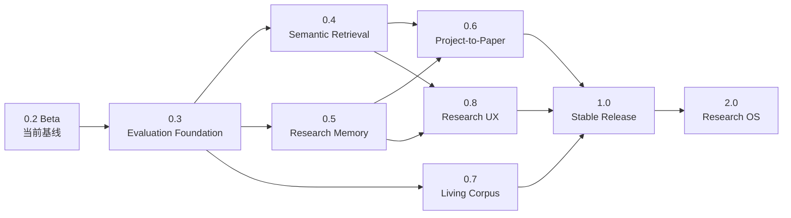

# AgenticResearchLab Roadmap

> 从 evidence-grounded `0.2 Beta` 走向可评测、可复现、可持续演进的 Agentic Research Operating System。

**Roadmap 基线：2026-08-09。** 本文定义下一阶段的优先级、任务、依赖和发布门槛；
[全面升级计划](next-upgrade-plan.md) 保留 `0.2` 的架构设计、Schema 和历史任务。

## 1. 当前起点

| 能力 | 已交付基线 | 仍需证明 |
| --- | --- | --- |
| 公共论文语料 | 1,242 篇 Paper v2 元数据 | 增量更新、版本关联与变化审计 |
| 代码地址 | 154 个实时验证通过的 GitHub 仓库 | 定期复验、仓库健康度与可复现性 |
| 本地全文 | 989/989 PDF，30,909 个页码级 Chunk | 人工抽样的页码与文本质量 |
| 检索 | FTS5、可选向量、RRF 混合检索 | 中英文语义 Gold Set 与稳定的质量门槛 |
| Taxonomy | 194 个实体、4,816 条关系 | 人工一致性、实体消歧与可解释关系 |
| Proposal | Claim、Baseline、实验、消融、否决报告 | 专家评分、引用正确性与真实项目闭环 |
| 产品界面 | 本地 Dashboard/API 与 GitHub Pages | 研究工作区、可分享状态和无障碍质量 |
| 工程质量 | 27 项测试、CI、Schema 和公开安全扫描 | 发布迁移、跨平台安装与长期回归 |

当前版本已经是完整的端到端 Beta，但还不能仅凭确定性 smoke 指标宣称解决了语义检索、
taxonomy 或研究创新。`1.0` 的核心任务是把“能运行”升级为“有人工证据证明可靠”。

## 2. North Star

用户输入一个研究选题、种子论文或本地工程后，系统应在一个可恢复的研究工作区中输出：

1. 可定位到论文页码或工程文件的 Evidence Pack；
2. 最近工作、代码、Benchmark 和失败机制矩阵；
3. 经过 Agentic 必要性与九项否决门槛筛选的候选 Claim；
4. 公平预算的 Baseline、实验、消融、成本、安全和复现计划；
5. 每次检索、判断、修改和否决的来源、版本与历史记录。

系统的成功不以“生成了多少建议”衡量，而以建议是否可引用、可证伪、可执行和可复现衡量。

## 3. 发布原则

- **Evidence first：** 任何核心 Claim 必须回链到页码级论文证据或文件级工程证据。
- **固定工作流优先：** 必须与同预算的非 Agent、单 Agent 和固定流程 Baseline 比较。
- **人工评测不可绕过：** smoke set 只负责防回归，不代替语义检索和创新质量判断。
- **Local first：** PDF、全文、向量、私人工程和研究记忆默认留在忽略的 `.arl/`。
- **Public safe：** Pages 和 Git 仓库只发布可公开的元数据、聚合指标和可验证链接。
- **不执行不可信代码：** 工程分析默认只读；第三方仓库执行必须进入显式隔离流程。
- **Gate driven：** 里程碑以退出条件完成，不以日历日期或代码行数完成。

## 4. Release train

### 0.3 — Evaluation Foundation（P0）

先建立可靠的尺子，再优化模型和算法。

| ID | 工作项 | 可交付结果 |
| --- | --- | --- |
| ARL-401 | 全文抽样 Gold Set | 至少 100 个跨会议 PDF 样本，人工确认页码、标题、段落与 Chunk 边界 |
| ARL-402 | 中英文语义检索 Gold Set | 至少 120 个自然研究 Query，覆盖同义、跨语言、否定条件和困难负例 |
| ARL-403 | 引用定位 Gold Set | 至少 100 个 Query–Claim–Evidence 三元组，人工确认论文与页码 |
| ARL-404 | Proposal 专家评审集 | 至少 30 个选题，采用必要性、差异性、可证伪性、实验充分性和风险量表 |
| ARL-405 | 统一评测报告 | `arl evaluate` 输出机器可读 JSON、Markdown 报告、数据版本与基线差异 |
| ARL-406 | 回归策略分层 | smoke、human Gold、慢速本地评测分别进入 required、scheduled、manual gate |

退出条件：

- 全文样本的正文提取成功率不低于 98%，错误必须有可追踪分类；
- 人工语义 Gold 上 `Recall@20 ≥ 0.85`、`nDCG@20 ≥ 0.75`；
- 引用论文准确率不低于 98%，页码定位准确率不低于 95%；
- Proposal 评审完成双人标注，分歧有裁决记录，评分量表进入仓库；
- 每项指标都能绑定语料版本、评测集版本和运行配置。

> 这是整个 Roadmap 唯一不可由自动化替代的人工检查点，也是 `1.0` 最关键的可信度来源。

### 0.4 — Semantic Retrieval & Citation（P0）

用 0.3 的人工尺子升级检索，不用增加 Agent 数量掩盖召回问题。

| ID | 工作项 | 可交付结果 |
| --- | --- | --- |
| ARL-411 | 可插拔 Embedding 接口 | hash、sentence-transformers 与后续 provider 共用版本化协议 |
| ARL-412 | 两阶段排序 | metadata/fulltext/vector 召回后接可选 reranker，保留每阶段得分 |
| ARL-413 | 结构化过滤 | 会议、年份、任务、环境、方法、代码状态和证据类型过滤 |
| ARL-414 | Citation Validator | 校验引用论文、页码、Chunk hash 与支持关系，拒绝无证据 Claim |
| ARL-415 | 检索解释 | 展示召回通道、字段命中、关系路径、rerank 变化和 Evidence 选择理由 |
| ARL-416 | 性能预算 | 固定参考机器上的构建时间、查询延迟、内存和索引大小基线 |

退出条件：

- 达到 0.3 的人工 Gold 门槛，并相对 `0.2` 基线无关键切片退化；
- 所有 Proposal Claim 均携带可验证 Evidence ID，不允许悬空引用；
- 元数据查询 `p95 < 1s`、本地混合检索 `p95 < 3s`，超限有诊断数据；
- 在无网络、无模型密钥环境下仍有确定性可用路径。

### 0.5 — Research Memory & Workspace（P1）

把一次性报告升级为可恢复、可比较的长期研究记忆。

| ID | 工作项 | 可交付结果 |
| --- | --- | --- |
| ARL-421 | Workspace Schema v2 | Topic、Query、Evidence、Claim、Decision、Experiment 和 Artifact 的版本化模型 |
| ARL-422 | Claim–Evidence Graph | 记录支持、反驳、替代、来源版本和失效状态 |
| ARL-423 | 决策与否决历史 | 保存候选为何通过、被否决、恢复或被用户修改 |
| ARL-424 | 可恢复执行 | 阶段 checkpoint、幂等重跑、失败续跑和生成物 checksum |
| ARL-425 | 可移植归档 | 导出公开安全的 `.arl-workspace`，私有内容默认脱敏且不进入 Git |
| ARL-426 | Memory Policy | 工作区隔离、保留期、删除、导出和来源可见性规则 |

退出条件：

- 相同输入、配置和数据版本可重建相同结构化结果（时间戳等非语义字段除外）；
- 中断后可以从最近 checkpoint 恢复，不产生重复 Evidence 或 Claim；
- 不同工作区无数据串联，公开导出通过安全扫描；
- 用户能检查某个 Claim 的完整来源和变更历史。

### 0.6 — Project-to-Paper Reproducibility（P1）

让“给工程加 Agentic”变成有工程证据和真实实验约束的研究设计。

| ID | 工作项 | 可交付结果 |
| --- | --- | --- |
| ARL-431 | 工程适配器 | Python、Node、Flutter 与 Swift 项目的只读能力、测试、依赖和约束画像 |
| ARL-432 | Baseline Builder | 自动生成固定流程、单 Agent、多 Agent 与 Oracle 的公平预算比较表 |
| ARL-433 | Experiment Contract | 数据、指标、预算、随机种子、停止条件、消融和失败判据 Schema |
| ARL-434 | Reproducibility Card | 环境、命令、依赖、许可证、硬件、成本与已知限制 |
| ARL-435 | 隔离执行设计 | 第三方代码执行的容器、网络、资源、超时和产物边界；默认关闭 |
| ARL-436 | 真实案例 | 至少 3 个端到端工程案例，其中至少 1 个 Mobile Agentic 项目 |

退出条件：

- 3 个案例都能从工程画像重建 Proposal、Baseline 和 Experiment Contract；
- 核心能力与缺口都能回链到工程相对路径或论文页码；
- 每个 Agentic 候选都说明固定流程为何不足，并给出等预算对照；
- 默认路径不执行项目脚本、不读取秘密文件、不上传私有内容。

### 0.7 — Living Corpus & Knowledge Graph（P1）

从 2026 静态快照升级为可增量维护的研究知识底座。

| ID | 工作项 | 可交付结果 |
| --- | --- | --- |
| ARL-441 | Source Connector 协议 | 会议、arXiv/OpenReview、代码和人工导入使用统一来源记录 |
| ARL-442 | 增量同步 | checkpoint、重试、限速、断点恢复和数据差异报告 |
| ARL-443 | 论文版本关系 | preprint、会议版、修订版、撤回与替代关系，不重复计数 |
| ARL-444 | 实体消歧 | 任务、方法、Benchmark、环境和失败模式的 alias 与人工裁决 |
| ARL-445 | 代码健康复验 | 可达性、归档、许可证、发布版本和最后验证时间 |
| ARL-446 | Corpus Release | 版本说明、Schema migration、checksum、增删改统计和回滚点 |

退出条件：

- 重复运行增量同步不丢记录、不重复计数，并能在失败后恢复；
- 每个字段都保留来源、首次/最后观察时间和人工覆盖优先级；
- 论文合并、拆分和版本迁移可审计、可回滚；
- 代码链接复验不会覆盖人工裁决。

### 0.8 — Research UX & Pages 2.0（P2）

让证据链和研究状态更容易被理解、审查和分享。

| ID | 工作项 | 可交付结果 |
| --- | --- | --- |
| ARL-451 | Paper Detail Page | 作者、摘要、地址、代码、taxonomy、相关工作与公开证据入口 |
| ARL-452 | 可分享检索状态 | Query、筛选与排序进入 URL，不携带本地全文或私人内容 |
| ARL-453 | Workspace UI | Evidence Inbox、最近工作矩阵、Claim 图、实验计划和否决历史 |
| ARL-454 | Provider Adapter | 可选本地模型及外部模型接口；密钥只从本机运行时读取 |
| ARL-455 | Accessibility | 键盘路径、语义标签、对比度、响应式和 reduced-motion 验收 |
| ARL-456 | Observability | 本地阶段耗时、缓存命中、检索诊断和可关闭的匿名聚合设计 |

退出条件：

- 公共 Pages 不依赖服务端密钥，不包含 PDF 全文、向量或私有工作区；
- 核心浏览与检索流程可用键盘完成，并通过自动无障碍检查；
- 任意检索结果可解释，任意 Claim 可沿 UI 回到 Evidence；
- 外部模型不可用时，本地确定性工作流仍能完成。

### 1.0 — Stable Release（P0 release gate）

`1.0` 不是新的功能包，而是以上能力的可信发布门槛。

| ID | 发布项 | 必须满足 |
| --- | --- | --- |
| ARL-501 | Quality Gate | 0.3 人工评测达标，关键切片无未解释退化 |
| ARL-502 | Reproducibility Gate | 3 个真实案例通过，至少 1 个 Mobile Agentic 案例 |
| ARL-503 | Packaging Gate | macOS、Linux、Windows 的干净环境安装、升级和卸载说明 |
| ARL-504 | Migration Gate | Schema/Workspace/Index 迁移、备份、回滚和兼容策略 |
| ARL-505 | Security Gate | 秘密、私有路径、依赖、许可证、发布物和 Pages 扫描通过 |
| ARL-506 | Documentation Gate | 快速开始、概念、CLI/API、故障排除和完整案例与当前行为一致 |
| ARL-507 | Release Gate | 版本、Changelog、tag、Wheel、checksum、Pages 和 GitHub Release 一致 |

只有全部 Gate 通过，README 才能将混合检索、taxonomy、Proposal 和工程到论文从
`Beta` 标为 `Stable`。

## 5. 1.0 之后：2.0 Research OS

以下方向进入 `1.x/2.0` 探索池，不阻塞 `1.0`：

- 插件式论文源、向量库、模型、Benchmark 和项目适配器；
- 多人研究工作区、评论、审批、角色和 Evidence 冲突裁决；
- 可重放的实验执行器与受控算力队列；
- 时间感知知识图谱、技术演化路径和过期 Claim 提醒；
- 面向领域的 Research Packs，例如 Mobile、Embodied、Coding、Science Agent；
- 对外稳定 Python API、CLI protocol 和本地 MCP/AgentWorkOS 集成；
- 在固定预算和同一 Evidence Pack 下比较不同研究 Agent，而不是比较 Token 消耗。

`2.0` 的进入条件是：`1.0` 的质量门槛连续两个语料版本保持稳定，并且插件边界能被至少
两个独立 Research Pack 验证。

## 6. 建议执行顺序

### Next sprint：先关闭可信度缺口

1. 合并并冻结当前 `0.2.0` Beta 基线，生成可回滚 tag；
2. 完成 ARL-401 全文抽样规范与第一批双人标注；
3. 完成 ARL-402 中英文 Query 模板、切片和困难负例规范；
4. 完成 ARL-403 Claim–Evidence 标注格式与引用裁决规则；
5. 让 `arl evaluate` 支持命名评测套件、版本和差异报告；
6. 建立 0.3 的 CI required/advisory/manual 三层 Gate。

### Following sprint：用 Gold Set 驱动检索

1. 实现统一 Retriever/Reranker 接口；
2. 加入字段过滤、分阶段分数和检索解释；
3. 实现 Citation Validator；
4. 对人工 Gold 的失败样本做错误分类，不只调一个总分；
5. 冻结 `0.4` 性能与质量基线。

### Then：并行推进 Memory、真实工程和动态语料

- `0.5` 先稳定 Workspace Schema，再做 UI；
- `0.6` 先选定 3 个真实案例，再扩展工程适配器；
- `0.7` 先做来源与差异审计，再增加新会议数量；
- `0.8` 只消费稳定 API，不把研究逻辑重新实现到前端。

## 7. 持续度量看板

| 维度 | 核心指标 | 1.0 门槛 |
| --- | --- | --- |
| 数据完整性 | Schema、checksum、来源、版本迁移 | required checks 全绿 |
| 全文质量 | 正文提取与页码定位 | ≥ 98% / ≥ 95% |
| 语义检索 | Recall@20 / nDCG@20 | ≥ 0.85 / ≥ 0.75 |
| 引用正确性 | 论文准确率 / 页码准确率 | ≥ 98% / ≥ 95% |
| Proposal 质量 | 专家量表、分歧率、Evidence 覆盖 | 发布前冻结基线并达标 |
| 工程闭环 | 可重建真实案例 | ≥ 3，含 1 个 Mobile |
| 性能 | metadata / hybrid p95 | < 1s / < 3s |
| 安全 | secrets、private paths、unsafe execution | 0 个 release blocker |
| 可复现 | 固定版本重建与中断恢复 | 100% release cases |

每次发布都应把指标快照写入版本化评测报告。没有人工 Gold 结果的版本可以继续作为
Beta 发布，但不能提升为 Stable。

## 8. 明确不做

- 不把“更多 Agent、更多轮对话、更多 Token”直接当作论文创新；
- 不承诺自动判断一项工作一定具有学术新颖性；
- 不自动运行下载的第三方仓库或用户工程；
- 不向 GitHub Pages 上传 PDF 全文、向量、私有工程、密钥或研究记忆；
- 不用模型自评完全替代人工 Gold 和盲审；
- 不为了扩大论文数而降低 Agentic 相关性、来源或代码验证标准。

## 9. Roadmap 完成定义

一个任务只有同时满足以下条件才可标记完成：

1. 实现、Schema、文档和生成物一致；
2. 有针对成功、失败和边界情况的自动测试；
3. 通过公开安全扫描，不泄露秘密、私有路径或本地语料；
4. 指标进入版本化评测报告，或明确说明为何不适用；
5. 用户可从 CLI/API 或界面验证结果；
6. Changelog、Roadmap 状态和发布版本同步更新。

