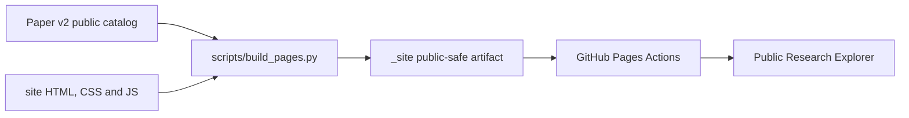

# GitHub Pages deployment

AgenticResearchLab publishes a static, public-safe Research Explorer at
[harzva.github.io/AgenticResearchLab](https://harzva.github.io/AgenticResearchLab/).

## What is deployed

The Pages artifact contains:

- the responsive site under `site/`;
- a minimized browser-search projection of the public Paper v2 catalog;
- `.nojekyll` and deterministic build metadata.

It does not contain local PDFs, extracted full text, vectors, SQLite databases, project profiles,
credentials, private paths, or `.arl/` workspaces. The website is intentionally a discovery
surface; page-aware Evidence and Proposal generation remain local capabilities.

## Local preview

```bash
python scripts/build_pages.py
python scripts/serve_pages.py
# open http://127.0.0.1:18767
```

The builder reads the canonical public catalog and creates the ignored `_site/` directory. The
same command runs in CI and GitHub Pages Actions, so the deployed counts and links cannot drift
from the repository data unnoticed.

## Deployment flow



`.github/workflows/pages.yml` builds and deploys the site with GitHub's official Pages actions.
The workflow verifies that the declared paper count matches the generated records and checks the
`.nojekyll` boundary before upload.
The deploy path additionally runs the repository safety scan and a second scan over the exact
generated Pages artifact.

## Visual regression assets

README screenshots are reproducible with:

```bash
node /path/to/readme-showcase-screenshot/scripts/capture-static.mjs \
  --config showcase-pages.config.json
```

Generated desktop, explorer, mobile, hero, gallery, and manifest assets live under
`docs/readme-assets/pages/`.
